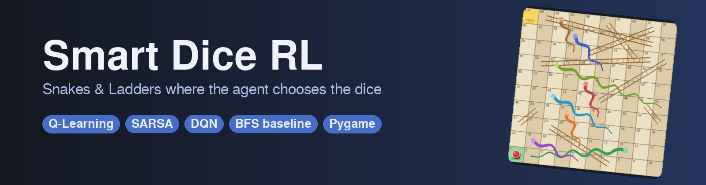
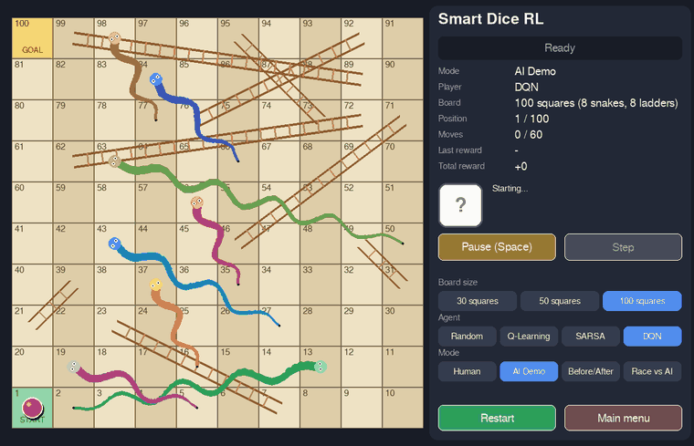
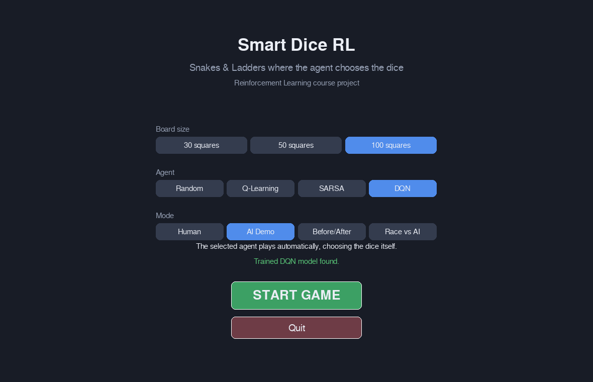
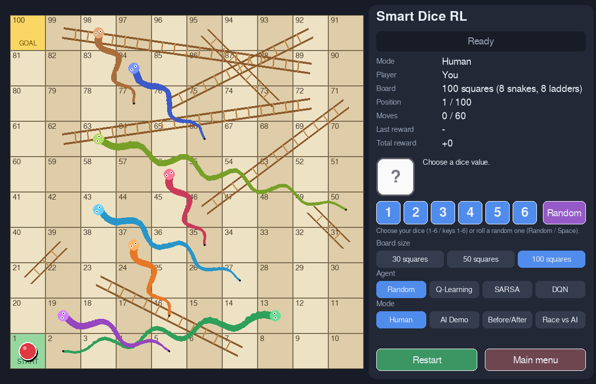
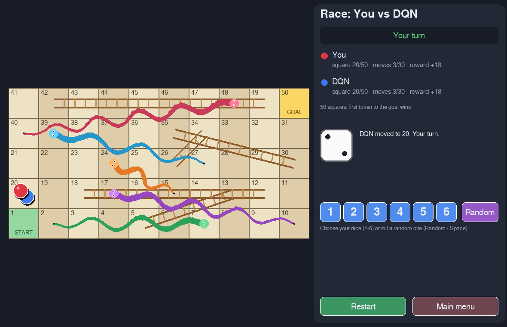
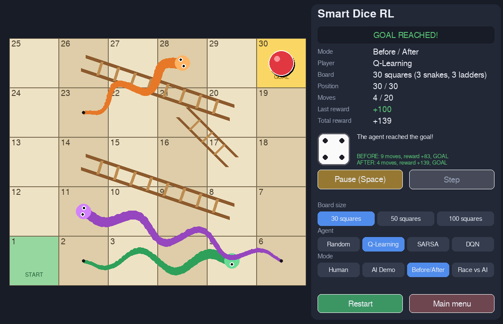
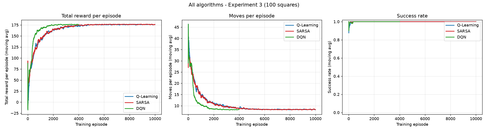
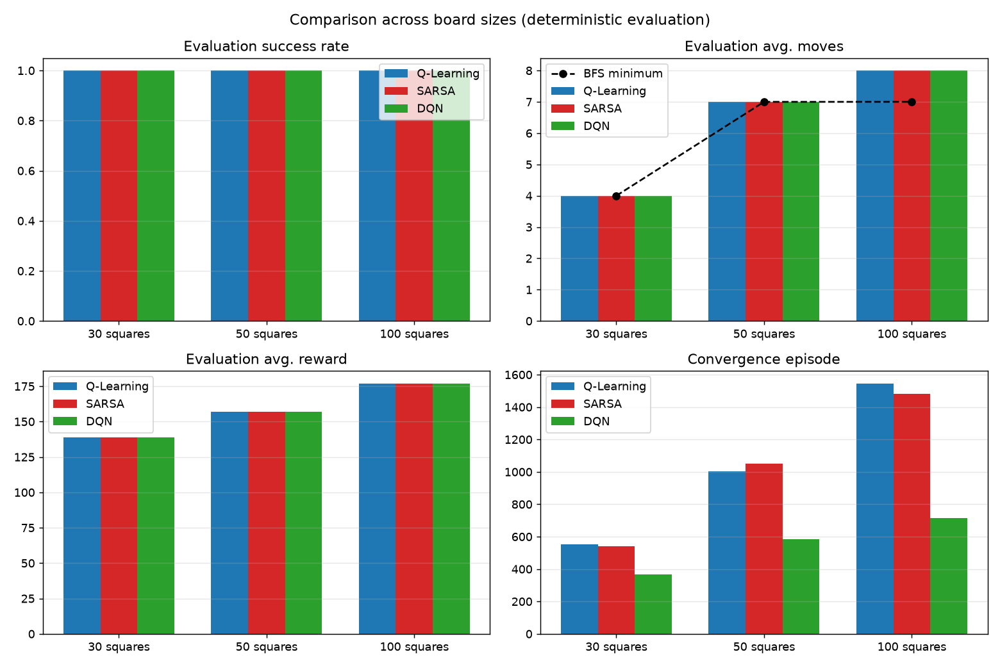
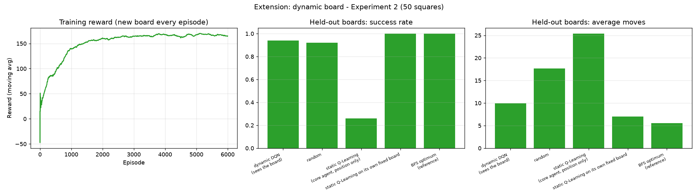
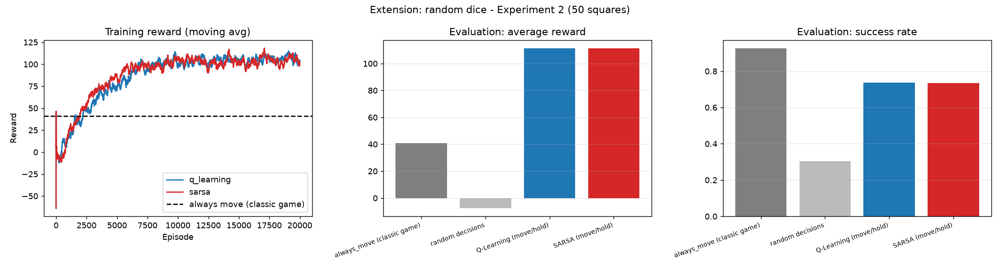

<p align="center">
  
</p>

<p align="center">
  
  
  
  
  
  <a href="LICENSE"></a>
</p>

<h1 align="center">Smart Dice RL</h1>
<p align="center"><b>Snakes &amp; Ladders where the agent chooses the dice.</b><br>
Tabular Q-Learning, SARSA and a PyTorch DQN learn to win by pure interaction - benchmarked against a BFS optimum and wrapped in a playable Pygame game.</p>

<p align="center">
  
  <br><sub>A trained DQN agent playing the 100-square board: it chooses every dice value itself.</sub>
</p>

---

## Highlights

- **A real RL problem.** The agent picks a dice value (1-6) each turn. It must learn to climb ladders, dodge snakes and hit the goal square *exactly* (overshooting is a -10 penalty).
- **Three algorithms, one fair comparison.** Q-Learning, SARSA and DQN (replay buffer + target network) on three boards (30 / 50 / 100 squares), identical seeds and boards, metrics saved as CSV.
- **BFS baseline** for the true minimum number of moves - used only as a reference, never by the agents.
- **Playable game.** Pygame UI with animated token, dice, snakes and ladders. Play yourself (pick the dice *or* roll randomly), watch an agent, compare an untrained vs trained agent, or **race an AI**.
- **Optional extensions.** Dynamic boards that change every episode, random dice (move/hold decisions), and multiplayer races.
- **One rule book.** Training, evaluation, BFS and the GUI all use the same `GameEngine` - no duplicated game logic.
- **Reproducible and tested.** Fixed seeds, 40 pytest tests, no hard-coded metrics.

## Gallery

| Start menu | Human mode (choose the dice or roll random) |
|:---:|:---:|
|  |  |
| **Race vs AI** | **Before / After training** |
|  |  |

## Quick start

```bash
git clone https://github.com/RahmaDawy/Smart-Dice-RL
cd Smart-Dice-RL

python -m venv .venv
# Windows PowerShell:  .venv\Scripts\Activate.ps1
# macOS / Linux:       source .venv/bin/activate
pip install -r requirements.txt

python run_project.py game      # play right away - trained models are included
```

Reproduce everything from scratch (a few minutes on a laptop CPU, no GPU needed):

```bash
python run_project.py all                    # train 3 algorithms x 3 boards, evaluate, make plots
python run_project.py extensions --which all # optional extras
python run_project.py test                   # 40 tests
```

## Results

Greedy policy, 100 unseen evaluation episodes, deterministic board (numbers from the run included in this repo; re-run to regenerate).

| Board | Method | Success | Avg moves | Avg reward | Convergence episode | Train time |
|---|---|---:|---:|---:|---:|---:|
| **30** | BFS optimum | - | 4 | 139 | - | - |
| | Random | 87% | 12.9 | 32 | - | - |
| | Q-Learning | 100% | 4.0 | 139 | 553 | <1s |
| | SARSA | 100% | 4.0 | 139 | 539 | 1s |
| | DQN | 100% | 4.0 | 139 | 361 | 7s |
| **50** | BFS optimum | - | 7 | 157 | - | - |
| | Random | 89% | 19.7 | 31 | - | - |
| | Q-Learning | 100% | 7.0 | 157 | 1,004 | 1s |
| | SARSA | 100% | 7.0 | 157 | 1,049 | 1s |
| | DQN | 100% | 7.0 | 157 | 534 | 22s |
| **100** | BFS optimum | - | 7 | 157 | - | - |
| | Random | 94% | 32.9 | 30 | - | - |
| | Q-Learning | 100% | 8.0 | 177 | 1,546 | 2s |
| | SARSA | 100% | 8.0 | 177 | 1,481 | 2s |
| | DQN | 100% | 8.0 | 177 | 740 | 47s |

**Reading the table.** All three learners match or beat BFS on *reward* while using a similar number of moves: BFS minimises moves, the agents maximise reward, and a slightly longer path through a ladder can pay more. The move limit is deliberately tight (20 / 30 / 60 moves) so that a random agent sometimes fails. Convergence = first episode where the 100-episode moving average stays within 10 % of the final plateau for 50 episodes.

<p align="center">
  <br>
  <sub>Training curves on the 100-square board (reward, moves, success rate).</sub>
</p>

<p align="center">
  <br>
  <sub>Comparison across board sizes, with the BFS minimum.</sub>
</p>

More plots (per algorithm, Q-Learning vs SARSA, every board) are in [`results/plots/`](results/plots) and all metrics in [`results/csv/`](results/csv).

## How it works

| MDP element | Definition |
|---|---|
| State | current square (`Discrete(N)`) |
| Action | dice value 1-6 (`Discrete(6)`) |
| Transition | deterministic; snakes/ladders applied immediately, no chaining |
| Reward | goal **+100**, ladder **+20**, normal **-1**, snake **-20**, invalid (overshoot) **-10** |
| Episode end | goal reached, or maximum episode length (truncation) |

- **Q-Learning** - off-policy TD control, `Q(s,a) += a (r + g max Q(s',.) - Q(s,a))`.
- **SARSA** - on-policy TD control, uses the action actually taken next.
- **DQN** - MLP on a one-hot state, experience replay, target network, Huber loss, Adam.
- **BFS** - shortest path on the known deterministic board; it cannot handle random or changing dynamics, which is exactly where RL is needed.

Full explanations: [docs/DETAILS.md](docs/DETAILS.md).

## Extensions

Optional extras that leave the core project untouched (`python run_project.py extensions --which all`).

**Dynamic board** - snakes and ladders change every episode. The agent sees what each dice value would do from its square, so one DQN works on boards it never trained on.

| Policy (held-out boards) | Success | Avg moves | Avg reward |
|---|---|---|---|
| dynamic DQN (sees the board) | 0.92 | 8 | 161.44 |
| random | 0.92 | 17.66 | 47.48 |
| static Q-Learning (core agent, position only) | 0.26 | 25.38 | -147.45 |
| static Q-Learning on its own fixed board | 1 | 7 | 157 |
| BFS optimum (reference) | 1 | 5.53 | 170.23 |

<p align="center"></p>

**Random dice** - the environment rolls the dice, so the agent decides *move* or *hold* (skip) after seeing the roll.

| Policy | Success | Avg moves | Avg reward | Hold rate |
|---|---|---|---|---|
| always_move (classic game) | 0.93 | 19.41 | 40.85 | 0 |
| random decisions | 0.3 | 28.35 | -7.66 | 0.5 |
| Q-Learning (move/hold) | 0.74 | 23.5 | 111.47 | 0.62 |
| SARSA (move/hold) | 0.73 | 23.66 | 111.22 | 0.66 |

<p align="center"></p>

**Multiplayer race** - you vs an agent in the game (Mode: *Race vs AI*), or agent vs agent via `extension_multiplayer.csv`.

## Project structure

```
Smart-Dice-RL/
├── configs/        board configs + reward function, hyper-parameters, paths
├── environment/    Board + rules, GameEngine, Gymnasium env, board generator
├── algorithms/     q_learning.py, sarsa.py, dqn.py, registry (load/save by name)
├── training/       shared training loops + one script per algorithm
├── evaluation/     evaluate.py, bfs_baseline.py, compare_models.py, metrics.py
├── visualization/  matplotlib plots + Pygame renderer
├── game/           main loop, menu, race scene
├── extensions/     dynamic board, random dice, multiplayer
├── models/         trained models (.npz / .pt)
├── results/        csv/ and plots/
├── tests/          40 pytest tests
├── docs/           technical details + README assets
└── run_project.py  single entry point (train / evaluate / plots / game / test / extensions)
```

## Controls

| Key | Action |
|---|---|
| `1`-`6` | choose your dice value (Human / Race) |
| `Space` | random roll (Human / Race) - pause/resume (AI modes) |
| `R` | restart |
| `Esc` | back to menu |

## License

[MIT](LICENSE). Built as a university Reinforcement Learning course project.
